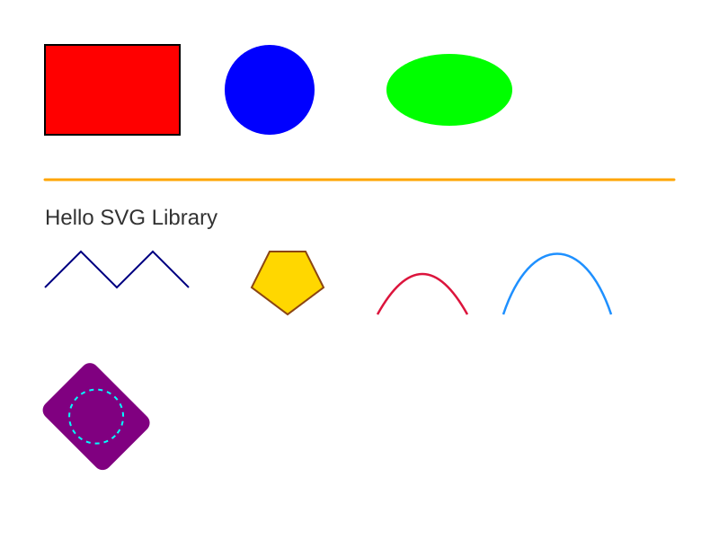

# svg-tec (C++)

A small, header-only C++17 library for generating SVG graphics.

This is an educational project, built for learning purposes. Each shape owns its own style (fill, stroke, transform) instead of relying on a mutable drawing context; the fluent, chainable method calls (`.fill().stroke()...`) are inspired by [SVG.js](https://svgjs.dev/).



## Features

- Shapes: `Rectangle`, `Circle`, `Ellipse`, `Line`, `Polyline`, `Polygon`, `Wedge`, `QuadCurve`, `CubicCurve`, `Text`, `Group`
- Curves (`QuadCurve`, `CubicCurve`) and `Wedge` are sampled into `<polyline>`/`<polygon>` points, no `<path>` element involved
- Every shape owns its own style (fill, stroke, transform) instead of relying on a mutable drawing context
- Fluent, chainable API: `doc.rect(10,20,30,40).fill("#ff0000").stroke("#000000").stroke(2.0);`
- `Group` and `Svg` share the same shape-creation methods (both inherit from `ShapeContainer`), so nesting groups works the same way as the top-level document
- Colors from RGB ints, hex strings (`"#ff0000"`, `"0xff0000"`, `"ff0000"`), or `Color::hex(0xff0000)`
- `translate`, `rotate`, `scale`, `skewX`, `skewY` compose directly onto a shape's transform
- `doc.save("file.svg")` writes the document to disk, no file handling required

## Requirements

- A C++17 compiler (no other dependencies, header-only)

## Usage

Copy `svg_tec.hpp` into your project and include it:

```cpp
#include "svg_tec.hpp"

using namespace SVG;

int main() {
  Svg doc(800, 600);

  doc.rect(50, 50, 150, 100).fill("#ff0000").stroke("#000000").stroke(2.0);
  doc.circle(300, 100, 50).fill("#0000ff");
  doc.line(50, 200, 750, 200).stroke("0xffa500").stroke(3.0).cap(Svg::ROUND);
  doc.text(50, 250, "Hello SVG").font("Arial", 24).fill("#323232");

  auto& g = doc.group();
  g.translate(100, 400).rotate(45);
  g.rect(0, 0, 100, 80, 10).fill("#800080");

  doc.save("output.svg");
}
```

See [`example.cpp`](example.cpp) for a complete demonstration of every shape and feature. Build and run it with:

```
g++ -std=c++17 -o example example.cpp
./example
```

## API overview

### Document and groups

`Svg` and `Group` both inherit from `ShapeContainer`, so they share the same shape-creation methods below. Each one creates the shape, attaches it to the container, and returns a reference to it so you can keep chaining style calls.

| Method | Description |
|---|---|
| `Svg(width, height)` | Creates a document with the given canvas size |
| `.rect(x, y, w, h, rx=0)` | Adds a `Rectangle`, optionally rounded |
| `.circle(cx, cy, r)` | Adds a `Circle` |
| `.ellipse(cx, cy, rx, ry)` | Adds an `Ellipse` |
| `.line(x1, y1, x2, y2)` | Adds a `Line` |
| `.polyline(points)` | Adds a `Polyline` from a vector of `{x,y}` points |
| `.polygon(points)` | Adds a closed `Polygon` from a vector of `{x,y}` points |
| `.wedge(x, y, r1, r2, a1, a2)` | Adds a `Wedge`: the annular sector centered at `(x,y)` between radii `r1` and `r2`, swept from angle `a1` to `a2` (degrees, 0° = +x axis, increasing clockwise). Pass `r1 = 0` for a plain pie slice |
| `.quadCurve(x1, y1, cx, cy, x2, y2)` | Adds a quadratic Bezier curve, sampled into a `Polyline` |
| `.cubicCurve(x1, y1, cx1, cy1, cx2, cy2, x2, y2)` | Adds a cubic Bezier curve, sampled into a `Polyline` |
| `.text(x, y, content)` | Adds a `Text` element |
| `.group()` | Adds a nested `Group`, itself a `ShapeContainer` |
| `.add(shape)` | Attaches an already-created `shared_ptr<Shape>` |
| `.save(filename)` | Writes the SVG document to a file |
| `.toString()` | Returns the SVG document as a string |

### Shape styling (available on every shape)

| Method | Description |
|---|---|
| `.fill(color)` / `.noFill()` | Sets or disables the fill |
| `.stroke(color)` / `.stroke(width, dash="")` / `.noStroke()` | Sets stroke color, stroke width/dash array, or disables the stroke |
| `.cap(Svg::BUTT \| Svg::ROUND \| Svg::SQUARE)` | Sets `stroke-linecap` |
| `.transform(t)` / `.translate(x,y)` / `.rotate(a,cx,cy)` / `.scale(sx,sy)` / `.skewX(a)` / `.skewY(a)` | Sets or composes the shape's transform |

### Colors

```cpp
Color(255, 0, 0)
Color("#ff0000")
Color("0xff0000")
Color::hex(0xff0000)
```

An invalid hex string throws `std::invalid_argument`.

## License

MIT — see [LICENSE](LICENSE).
